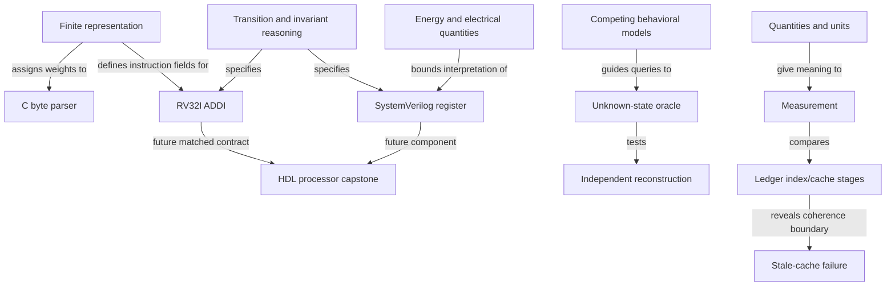

# Knowledge Graph

## Established relationships

Four reviewed relationships are now supported by the prepared Code unit, not by learner assessments. Learner knowledge remains unassessed. Claim IDs and edge IDs are recorded in [catalog.json](registries/catalog.json).

| Edge | Relationship | Support / limit |
| --- | --- | --- |
| K-CODE-01 | Shared mapping assigns interpretation to a symbol pattern | C-CODE-01, Chapter 1 PDF 6–8; agreed table required |
| K-CODE-02 | Agreed time scale constrains classification of observed duration | C-CODE-02/03, PDF 8–9; exact ideal timing |
| K-CODE-03 | Character boundary closes an unfinished decoder pattern | C-CODE-06/07, original derivation; explicit EOF closes final pattern |
| K-CODE-04 | Discarded distinction can prevent exact recovery | C-CODE-08, collision proof; extra information may change the problem |

See the [unit graph](books/code-petzold/generated/chapters/01/03_CONCEPT_GRAPH.md), [proofs](books/code-petzold/generated/chapters/01/06_FORMALISMS.md) and [claim locators](books/code-petzold/generated/chapters/01/11_SOURCE_REFERENCES.md). No claim of measured physical reliability or external Morse compliance is made.

## Edge contract

Add an edge to `knowledge_edges` in [catalog.json](registries/catalog.json) only when a learning artifact establishes it. Each record needs `id`, `from`, `relation`, `to`, `claim_ids`, `artifact` and `limitations`. Use a meaningful relation such as “represents,” “implements,” “constrains,” “depends on” or “measures”; an unlabeled arrow is insufficient. Link an inspected source-backed claim and distinguish conceptual establishment from learner mastery.

Mirror reviewed edges here with a concise explanation. Revisit edges when evidence changes. Counterexamples and model boundaries belong beside the edge, not hidden in a footnote.

## Planning boundary

Potential paths involving instructions and CPUs, pointers and virtual memory, files and databases, sockets and distributed communication, or probability and inference remain in [PREREQUISITE_GRAPH.md](PREREQUISITE_GRAPH.md). They are not asserted as established knowledge here.

The two organizing chains in [LEARNING_SYSTEM.md](LEARNING_SYSTEM.md) are the owner's curriculum design. Security verification and evidence about reality must remain distinct throughout future graph entries.

## Connected systems expansion: prepared reasoning and review boundaries

The following links connect original prepared artifacts; they are not new learner knowledge or automatically VERIFIED source claims. Retain the existing four reviewed Code edges. Human/source entailment review precedes promoting new candidates into the structured knowledge-edge collection.

Inspect the [C derivation](programming-languages-mastery/01-c/units/01-byte-parser/LESSON.md), [ISA derivation](programming-languages-mastery/07-riscv-assembly/units/01-addi/LESSON.md), [RTL model](hardware-description-languages/systemverilog/units/01-enabled-register/LESSON.md), [unknown-system prompt](reverse-engineering-systems/exercises/01-hidden-state/prompt.md) and [production assumptions](production-systems-engineering/labs/event-ledger/ASSUMPTIONS.md). ISA↔CPU edges are plans, not completed CPU evidence.

Vertical investigation routes (planning, not already reconstructed systems): application → runtime → OS/syscalls → drivers → ISA → microarchitecture → logic → transistors → electronics → physical effects; human interface → application/protocol → network/server → database/storage → physical medium; reality → sensor/signal → ADC/representation → computation/decision → control/actuator → physical change/feedback. Each arrow is an obligation to inspect an interface, state and failure mechanism. Descend to exact internal mathematics/physics/materials lessons when a dependency appears.
