# Prerequisite Graph

<!-- Generated from registries/catalog.json by tools/render.py; edit the catalog. -->

These edges are curriculum planning decisions, not established knowledge or evidence of mastery. A unit ID means the bounded capability in its exit gate, not completion of an entire field. Check learner evidence in [MASTERY.md](MASTERY.md). Concurrent means compatible after each unit’s own required gates, never permission to skip prerequisites.

## Required dependency graph

```mermaid
graph TD
  U00["U00: Source-grounded observation and study protocol"]
  U01["U01: Representation and computation foundations"]
  U02["U02: Logic, gates and combinational arithmetic"]
  U03["U03: State, memory, CPU and machine instructions"]
  U04["U04: Programming, debugging, files and Git"]
  U05["U05: Minimal process and file-descriptor bridge"]
  U06["U06: Proof, discrete structures and growth"]
  U07["U07: Data structures and algorithms"]
  U08["U08: Compiled programs and systems mechanisms"]
  U09["U09: Operating-system internals"]
  U10["U10: Networks and network programs"]
  U11["U11: Storage, databases and pipelines"]
  U12["U12: Evidence, measurement and scientific reasoning"]
  U13["U13: Probability, statistics and data analysis"]
  U14["U14: Controlled security and cryptography"]
  U15["U15: Privacy and verifiable provenance"]
  U16["U16: Languages and compilers"]
  U17["U17: Distributed storage and computation"]
  U18["U18: ML, gradients and evaluation"]
  U19["U19: Physical measurement, electronics and control"]
  U20["U20: Biological foundations and computation"]
  U21["U21: Bounded research reproduction"]
  F-COUNT["F-COUNT: Counting, quantities and units"]
  F-BITS["F-BITS: Finite positional representations"]
  F-STATE["F-STATE: State, logic and invariants"]
  F-ELECTRIC["F-ELECTRIC: Electrical quantities and digital abstraction"]
  F-CENTRY["F-CENTRY: C interface reading bridge"]
  L01["L01: C investigation route"]
  L02["L02: C++ investigation route"]
  L03["L03: Rust investigation route"]
  L04["L04: Zig investigation route"]
  L05["L05: x86-64 assembly investigation route"]
  L06["L06: ARM64 assembly investigation route"]
  L07["L07: RISC-V assembly investigation route"]
  L08["L08: Python investigation route"]
  L09["L09: Go investigation route"]
  L10["L10: Java investigation route"]
  L11["L11: SQL investigation route"]
  L12["L12: Shell/Bash investigation route"]
  L13["L13: SystemVerilog/Verilog investigation route"]
  L14["L14: VHDL investigation route"]
  U-CEX["U-CEX: Bounded C byte parser"]
  U-RVEX["U-RVEX: RV32I ADDI encoding and transition"]
  U-SVEX["U-SVEX: Synchronous enabled register"]
  U-REEX["U-REEX: Hidden-state investigation"]
  U-PROD["U-PROD: Event ledger production investigation"]
  U00 --> U01
  F-COUNT --> U01
  F-STATE --> U01
  U01 --> U02
  F-BITS --> U02
  F-ELECTRIC --> U02
  U02 --> U03
  U01 --> U04
  U04 --> U05
  U01 --> U06
  U04 --> U07
  U06 --> U07
  U03 --> U08
  U04 --> U08
  U05 --> U08
  U08 --> U09
  U05 --> U10
  U08 --> U10
  U07 --> U11
  U08 --> U11
  U04 --> U12
  U06 --> U12
  U12 --> U13
  U06 --> U14
  U09 --> U14
  U10 --> U14
  U11 --> U14
  U12 --> U14
  U13 --> U15
  U14 --> U15
  U07 --> U16
  U08 --> U16
  U09 --> U17
  U10 --> U17
  U11 --> U17
  U12 --> U17
  U07 --> U18
  U13 --> U18
  U03 --> U19
  U08 --> U19
  U12 --> U19
  U13 --> U19
  U07 --> U20
  U12 --> U20
  U13 --> U20
  U12 --> U21
  U13 --> U21
  F-COUNT --> F-BITS
  F-COUNT --> F-STATE
  F-COUNT --> F-ELECTRIC
  F-BITS --> F-CENTRY
  U04 --> L01
  U08 --> L02
  U08 --> L03
  U08 --> L04
  U03 --> L05
  U19 --> L06
  U03 --> L07
  U04 --> L08
  U10 --> L09
  U16 --> L10
  U11 --> L11
  U04 --> L12
  U02 --> L13
  U02 --> L14
  F-CENTRY --> U-CEX
  U01 --> U-CEX
  F-BITS --> U-RVEX
  F-STATE --> U-RVEX
  U01 --> U-RVEX
  F-BITS --> U-SVEX
  F-STATE --> U-SVEX
  F-ELECTRIC --> U-SVEX
  U01 --> U-SVEX
  F-COUNT --> U-REEX
  F-STATE --> U-REEX
  U00 --> U-REEX
  U04 --> U-PROD
  U11 --> U-PROD
  U12 --> U-PROD
  U13 --> U-PROD
```

## Entry gates and concurrency

| Unit | Required | Recommended | Concurrent | Resources |
| --- | --- | --- | --- | --- |
| U00 — Source-grounded observation and study protocol | None | None | None | R-CODE |
| U01 — Representation and computation foundations | U00, F-COUNT, F-STATE | None | None | R-CODE |
| U02 — Logic, gates and combinational arithmetic | U01, F-BITS, F-ELECTRIC | None | U04 | R-CODE, R-NAND |
| U03 — State, memory, CPU and machine instructions | U02 | None | U04 | R-CODE, R-ELEMENTS |
| U04 — Programming, debugging, files and Git | U01 | None | U02, U03 | R-PYTHON, R-C, R-DIVE |
| U05 — Minimal process and file-descriptor bridge | U04 | None | U06 | R-DIVE, R-CSAPP |
| U06 — Proof, discrete structures and growth | U01 | None | U04, U05 | R-DISCRETE |
| U07 — Data structures and algorithms | U04, U06 | None | None | R-ALGORITHMS, R-ALGO-PY |
| U08 — Compiled programs and systems mechanisms | U03, U04, U05 | U07 | None | R-CSAPP, R-DIVE |
| U09 — Operating-system internals | U08 | U07 | U10 | R-OSTEP, R-XV6, R-OSTEP-HW |
| U10 — Networks and network programs | U05, U08 | U09 | U09, U11 | R-NET, R-BEEJ |
| U11 — Storage, databases and pipelines | U07, U08 | U09, U10 | U10, U12 | R-DB, R-DDIA, R-SQLITE |
| U12 — Evidence, measurement and scientific reasoning | U04, U06 | None | U11 | R-CRAFT, R-DATA8, R-STATS |
| U13 — Probability, statistics and data analysis | U12 | U11 | U14 | R-STATS, R-PYDATA, R-LINEAR, R-CALCULUS |
| U14 — Controlled security and cryptography | U06, U09, U10, U11, U12 | U13 | U13 | R-SECURITY, R-CRYPTO, R-OWASP |
| U15 — Privacy and verifiable provenance | U13, U14 | None | None | R-PRIVACY, R-OWASP |
| U16 — Languages and compilers | U07, U08 | None | U17 | R-INTERPRETERS, R-INTERPRETERS-REPO |
| U17 — Distributed storage and computation | U09, U10, U11, U12 | U14 | U16 | R-DDIA, R-TOYDB |
| U18 — ML, gradients and evaluation | U07, U13 | U14 | None | R-HOML, R-MICROGRAD, R-LINEAR, R-CALCULUS |
| U19 — Physical measurement, electronics and control | U03, U08, U12, U13 | None | None | R-EMBEDDED, R-ROBOTICS, R-PHYSICS |
| U20 — Biological foundations and computation | U07, U12, U13 | None | None | R-CELL, R-CHEM, R-BIOPYTHON |
| U21 — Bounded research reproduction | U12, U13 | U17, U18, U19, U20 | None | R-CRAFT, R-STATS |
| F-COUNT — Counting, quantities and units | None | None | None | R-DISCRETE |
| F-BITS — Finite positional representations | F-COUNT | None | None | R-DISCRETE |
| F-STATE — State, logic and invariants | F-COUNT | None | None | R-DISCRETE |
| F-ELECTRIC — Electrical quantities and digital abstraction | F-COUNT | None | None | R-ELECTRIC |
| F-CENTRY — C interface reading bridge | F-BITS | None | None | R-C11 |
| L01 — C investigation route | U04 | None | None | R-C11 |
| L02 — C++ investigation route | U08 | None | None | R-LANG-CPP |
| L03 — Rust investigation route | U08 | None | None | R-LANG-RUST |
| L04 — Zig investigation route | U08 | None | None | R-LANG-ZIG |
| L05 — x86-64 assembly investigation route | U03 | None | None | R-LANG-X86 |
| L06 — ARM64 assembly investigation route | U19 | None | None | R-LANG-ARM |
| L07 — RISC-V assembly investigation route | U03 | None | None | R-RV32 |
| L08 — Python investigation route | U04 | None | None | R-LANG-PY |
| L09 — Go investigation route | U10 | None | None | R-LANG-GO |
| L10 — Java investigation route | U16 | None | None | R-LANG-JAVA |
| L11 — SQL investigation route | U11 | None | None | R-LANG-SQL |
| L12 — Shell/Bash investigation route | U04 | None | None | R-LANG-BASH |
| L13 — SystemVerilog/Verilog investigation route | U02 | None | None | R-SV |
| L14 — VHDL investigation route | U02 | None | None | R-LANG-VHDL |
| U-CEX — Bounded C byte parser | F-CENTRY, U01 | None | None | R-C11 |
| U-RVEX — RV32I ADDI encoding and transition | F-BITS, F-STATE, U01 | None | None | R-RV32 |
| U-SVEX — Synchronous enabled register | F-BITS, F-STATE, F-ELECTRIC, U01 | None | None | R-SV, R-IVERILOG |
| U-REEX — Hidden-state investigation | F-COUNT, F-STATE, U00 | None | None | R-CODE |
| U-PROD — Event ledger production investigation | U04, U11, U12, U13 | None | None | R-SQLITE-LAB |

## U00 — Source-grounded observation and study protocol

Phase P01. State: NOT STARTED.

Exit evidence: Identify the supplied edition and a source locator; distinguish a quotation, explanation, prediction and observation. Local intake is inspected; learner demonstration remains pending.

## U01 — Representation and computation foundations

Phase P01. State: NOT STARTED.

Exit evidence: Choose an explicit encoding, decode examples and explain assumptions; first book unit chosen only after actual source mapping.

## U02 — Logic, gates and combinational arithmetic

Phase P01. State: NOT STARTED.

Exit evidence: Derive truth tables and demonstrate exhaustive small-input tests, including overflow boundaries.

## U03 — State, memory, CPU and machine instructions

Phase P01. State: NOT STARTED.

Exit evidence: Predict register, memory and program-counter changes through a short instruction trace.

## U04 — Programming, debugging, files and Git

Phase P02. State: NOT STARTED.

Exit evidence: Write tested small programs; trace pointers and object lifetimes; preserve work with local Git.

## U05 — Minimal process and file-descriptor bridge

Phase P02. State: NOT STARTED.

Exit evidence: Explain process creation, execution, waiting and descriptor redirection before implementing the shell.

## U06 — Proof, discrete structures and growth

Phase P03. State: NOT STARTED.

Exit evidence: Use sets, functions, induction, invariants, sums and logarithms to justify a simple bound.

## U07 — Data structures and algorithms

Phase P03. State: NOT STARTED.

Exit evidence: Explain correctness, test edge cases, and measure representative workloads without conflating timing with complexity.

## U08 — Compiled programs and systems mechanisms

Phase P04. State: NOT STARTED.

Exit evidence: Trace linking, memory layout, syscalls and concurrency; allocator and compiled-program inspection share one systems lab.

## U09 — Operating-system internals

Phase P05. State: NOT STARTED.

Exit evidence: Trace a kernel operation and test an isolated xv6 modification.

## U10 — Networks and network programs

Phase P06. State: NOT STARTED.

Exit evidence: Implement local TCP and HTTP servers with framing, partial I/O and disconnect tests; TLS use precedes crypto internals.

## U11 — Storage, databases and pipelines

Phase P07. State: NOT STARTED.

Exit evidence: Test indexing, transactions and recovery; distributed database sections wait for U17; Rust bridge needed before toydb code.

## U12 — Evidence, measurement and scientific reasoning

Phase P08. State: NOT STARTED.

Exit evidence: Trace claim → analysis → data → measurement → collection → source → reality; identify confounding and uncertainty.

## U13 — Probability, statistics and data analysis

Phase P09. State: NOT STARTED.

Exit evidence: Model sampling and uncertainty; acquire linear algebra before multivariate regression and calculus before continuous models.

## U14 — Controlled security and cryptography

Phase P10. State: NOT STARTED.

Exit evidence: Apply modular arithmetic and discrete probability before crypto; test local threat boundaries with synthetic data.

## U15 — Privacy and verifiable provenance

Phase P11. State: NOT STARTED.

Exit evidence: Specify a privacy threat model and distinguish integrity/authenticity from evidential truth; prove a small privacy claim before advanced analytics.

## U16 — Languages and compilers

Phase P12. State: NOT STARTED.

Exit evidence: Implement syntax and semantics with negative tests; inspect Java prerequisites if following the original Java implementation.

## U17 — Distributed storage and computation

Phase P13. State: NOT STARTED.

Exit evidence: Choose an original consensus paper before consensus implementation; record safety/liveness assumptions and fault traces.

## U18 — ML, gradients and evaluation

Phase P14. State: NOT STARTED.

Exit evidence: First pass matrix algebra, derivatives, partial derivatives and chain-rule diagnostics; compare analytical and numerical gradients.

## U19 — Physical measurement, electronics and control

Phase P15. State: NOT STARTED.

Exit evidence: Verify circuit/physics sources; pass units, circuits, mechanics, calculus and differential-equation bridge before control; simulate before selecting hardware.

## U20 — Biological foundations and computation

Phase P16. State: NOT STARTED.

Exit evidence: Verify chemistry and biology sources; establish chemistry, cell biology, genetics and evolution before interpreting sequence analyses; no wet-lab work planned.

## U21 — Bounded research reproduction

Phase P17. State: NOT STARTED.

Exit evidence: Select one original paper and domain prerequisites; reproduce an analysis and delimit agreement, disagreement and uncertainty.

## F-COUNT — Counting, quantities and units

Phase P01. State: NOT STARTED.

Exit evidence: Use quantities/units and ratios correctly in an internal systems problem.

## F-BITS — Finite positional representations

Phase P01. State: NOT STARTED.

Exit evidence: Derive word range, byte order, modular arithmetic and signed interpretation.

## F-STATE — State, logic and invariants

Phase P01. State: NOT STARTED.

Exit evidence: Trace a transition table and justify initialization/preservation.

## F-ELECTRIC — Electrical quantities and digital abstraction

Phase P01. State: NOT STARTED.

Exit evidence: Derive energy/power relations and separate logical tests from device measurements.

## F-CENTRY — C interface reading bridge

Phase P02. State: NOT STARTED.

Exit evidence: Explain function, object, pointer, extent and output ownership in the bounded example.

## L01 — C investigation route

Phase P02. State: NOT STARTED.

Exit evidence: Complete bounded prepared units and demonstrate debugging, reconstruction and transfer; scaffold presence is not readiness.

## L02 — C++ investigation route

Phase P04. State: NOT STARTED.

Exit evidence: Complete bounded prepared units and demonstrate debugging, reconstruction and transfer; scaffold presence is not readiness.

## L03 — Rust investigation route

Phase P04. State: NOT STARTED.

Exit evidence: Complete bounded prepared units and demonstrate debugging, reconstruction and transfer; scaffold presence is not readiness.

## L04 — Zig investigation route

Phase P04. State: NOT STARTED.

Exit evidence: Complete bounded prepared units and demonstrate debugging, reconstruction and transfer; scaffold presence is not readiness.

## L05 — x86-64 assembly investigation route

Phase P04. State: NOT STARTED.

Exit evidence: Complete bounded prepared units and demonstrate debugging, reconstruction and transfer; scaffold presence is not readiness.

## L06 — ARM64 assembly investigation route

Phase P15. State: NOT STARTED.

Exit evidence: Complete bounded prepared units and demonstrate debugging, reconstruction and transfer; scaffold presence is not readiness.

## L07 — RISC-V assembly investigation route

Phase P04. State: NOT STARTED.

Exit evidence: Complete bounded prepared units and demonstrate debugging, reconstruction and transfer; scaffold presence is not readiness.

## L08 — Python investigation route

Phase P02. State: NOT STARTED.

Exit evidence: Complete bounded prepared units and demonstrate debugging, reconstruction and transfer; scaffold presence is not readiness.

## L09 — Go investigation route

Phase P06. State: NOT STARTED.

Exit evidence: Complete bounded prepared units and demonstrate debugging, reconstruction and transfer; scaffold presence is not readiness.

## L10 — Java investigation route

Phase P12. State: NOT STARTED.

Exit evidence: Complete bounded prepared units and demonstrate debugging, reconstruction and transfer; scaffold presence is not readiness.

## L11 — SQL investigation route

Phase P07. State: NOT STARTED.

Exit evidence: Complete bounded prepared units and demonstrate debugging, reconstruction and transfer; scaffold presence is not readiness.

## L12 — Shell/Bash investigation route

Phase P02. State: NOT STARTED.

Exit evidence: Complete bounded prepared units and demonstrate debugging, reconstruction and transfer; scaffold presence is not readiness.

## L13 — SystemVerilog/Verilog investigation route

Phase P01. State: NOT STARTED.

Exit evidence: Complete bounded prepared units and demonstrate debugging, reconstruction and transfer; scaffold presence is not readiness.

## L14 — VHDL investigation route

Phase P01. State: NOT STARTED.

Exit evidence: Complete bounded prepared units and demonstrate debugging, reconstruction and transfer; scaffold presence is not readiness.

## U-CEX — Bounded C byte parser

Phase P02. State: NOT STARTED.

Exit evidence: Explain, independently implement, test, debug, reconstruct and transfer; learner evidence required before advancement.

## U-RVEX — RV32I ADDI encoding and transition

Phase P04. State: NOT STARTED.

Exit evidence: Explain, independently implement, test, debug, reconstruct and transfer; learner evidence required before advancement.

## U-SVEX — Synchronous enabled register

Phase P01. State: NOT STARTED.

Exit evidence: Explain, independently implement, test, debug, reconstruct and transfer; learner evidence required before advancement.

## U-REEX — Hidden-state investigation

Phase P08. State: NOT STARTED.

Exit evidence: Explain, independently implement, test, debug, reconstruct and transfer; learner evidence required before advancement.

## U-PROD — Event ledger production investigation

Phase P07. State: NOT STARTED.

Exit evidence: Explain, independently implement, test, debug, reconstruct and transfer; learner evidence required before advancement.

## First unit

U00 is the entry protocol; U01 is the first subject unit. For current source readiness and the bounded first learning unit, see [FIRST_UNIT.md](01-computation/FIRST_UNIT.md). Internal foundations precede the existing Code reconstruction when learner evidence is absent.

## Internal prepared/scaffolded learning paths

| Unit | Artifact | Learner gate |
| --- | --- | --- |
| F-COUNT | [Internal lesson or map](foundations/mathematics/counting-and-units/README.md) | Evidence required; use tools/learning_gate.py |
| F-BITS | [Internal lesson or map](foundations/mathematics/finite-representations/README.md) | Evidence required; use tools/learning_gate.py |
| F-STATE | [Internal lesson or map](foundations/mathematics/state-and-logic/README.md) | Evidence required; use tools/learning_gate.py |
| F-ELECTRIC | [Internal lesson or map](foundations/physics/electrical-quantities/README.md) | Evidence required; use tools/learning_gate.py |
| F-CENTRY | [Internal lesson or map](foundations/programming/c-reading/README.md) | Evidence required; use tools/learning_gate.py |
| L01 | [Internal lesson or map](programming-languages-mastery/01-c/README.md) | Evidence required; use tools/learning_gate.py |
| L02 | [Internal lesson or map](programming-languages-mastery/02-cpp/README.md) | Evidence required; use tools/learning_gate.py |
| L03 | [Internal lesson or map](programming-languages-mastery/03-rust/README.md) | Evidence required; use tools/learning_gate.py |
| L04 | [Internal lesson or map](programming-languages-mastery/04-zig/README.md) | Evidence required; use tools/learning_gate.py |
| L05 | [Internal lesson or map](programming-languages-mastery/05-x86-64-assembly/README.md) | Evidence required; use tools/learning_gate.py |
| L06 | [Internal lesson or map](programming-languages-mastery/06-arm64-assembly/README.md) | Evidence required; use tools/learning_gate.py |
| L07 | [Internal lesson or map](programming-languages-mastery/07-riscv-assembly/README.md) | Evidence required; use tools/learning_gate.py |
| L08 | [Internal lesson or map](programming-languages-mastery/08-python/README.md) | Evidence required; use tools/learning_gate.py |
| L09 | [Internal lesson or map](programming-languages-mastery/09-go/README.md) | Evidence required; use tools/learning_gate.py |
| L10 | [Internal lesson or map](programming-languages-mastery/10-java/README.md) | Evidence required; use tools/learning_gate.py |
| L11 | [Internal lesson or map](programming-languages-mastery/11-sql/README.md) | Evidence required; use tools/learning_gate.py |
| L12 | [Internal lesson or map](programming-languages-mastery/12-shell-bash/README.md) | Evidence required; use tools/learning_gate.py |
| L13 | [Internal lesson or map](programming-languages-mastery/13-systemverilog/README.md) | Evidence required; use tools/learning_gate.py |
| L14 | [Internal lesson or map](programming-languages-mastery/14-vhdl/README.md) | Evidence required; use tools/learning_gate.py |
| U-CEX | [Internal lesson or map](programming-languages-mastery/01-c/units/01-byte-parser/README.md) | Evidence required; use tools/learning_gate.py |
| U-RVEX | [Internal lesson or map](programming-languages-mastery/07-riscv-assembly/units/01-addi/README.md) | Evidence required; use tools/learning_gate.py |
| U-SVEX | [Internal lesson or map](hardware-description-languages/systemverilog/units/01-enabled-register/README.md) | Evidence required; use tools/learning_gate.py |
| U-REEX | [Internal lesson or map](reverse-engineering-systems/exercises/01-hidden-state/README.md) | Evidence required; use tools/learning_gate.py |
| U-PROD | [Internal lesson or map](production-systems-engineering/labs/event-ledger/README.md) | Evidence required; use tools/learning_gate.py |

The graph is regenerated from catalog required edges. Prepared material does not satisfy a prerequisite. Check every discipline in PREREQUISITE_BRIDGE.md; scaffolded future lessons remain blocked for study.
