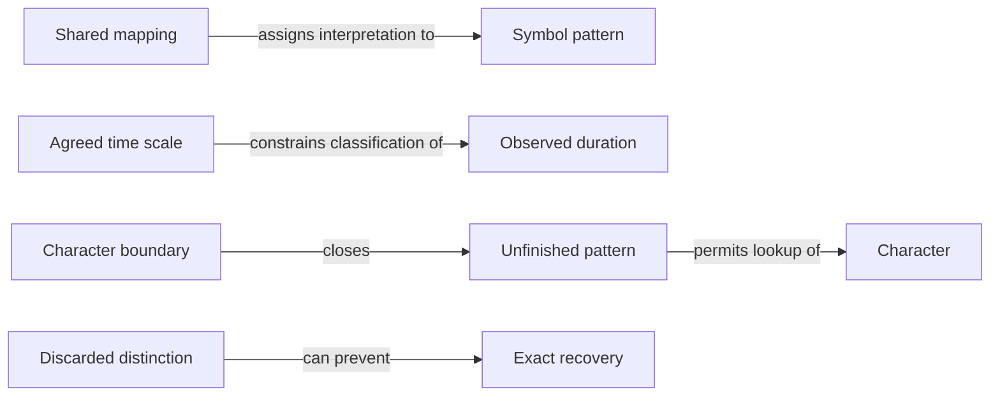

# Reviewed artifact relationships

These are supported relationships in prepared learning artifacts, **not established learner knowledge**. Claim IDs resolve in [references](11_SOURCE_REFERENCES.md) and the central catalog.

| Relationship | Support | Boundary |
| --- | --- | --- |
| Shared mapping assigns interpretation to a pattern | C-CODE-01; PDF 6–8 | Shared table and permitted alphabet required |
| Time scale constrains duration classification | C-CODE-02/03; PDF 8–9 | Exact ideal timing only |
| Boundary closes an unfinished pattern before lookup | C-CODE-06/07; original derivation | End-of-frame closes final pattern explicitly |
| Discarding distinctions can prevent exact recovery | C-CODE-08; original collision proof | Claim is about exact recovery, not probabilistic guessing |

Future gates, memory circuits, network framing and error control remain dependency targets, not mechanisms established by analogy here.
