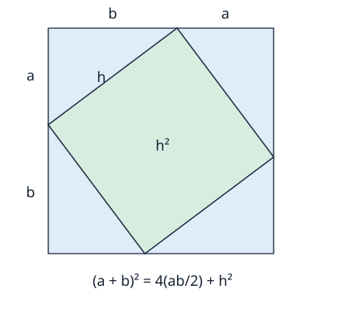

# Coordinates, angles and complex arithmetic

Prerequisite: [algebra/functions](01_ALGEBRA_FUNCTIONS.md). This bridge supplies
the geometry and complex arithmetic used by vectors, rotating machines, Fourier
calculations and quantum amplitudes. Coordinates describe a chosen reference;
the numbers alone do not identify a physical origin, axis or unit.

## 1. Distance and angle need conventions

In a flat Cartesian plane choose perpendicular axes with the same length unit.
A displacement (x,y) makes a right triangle with signed coordinate changes.
Its nonnegative length h satisfies h²=x²+y². One area argument explains this:
arrange four copies of a right triangle with positive legs a,b in a square of
side a+b. Their hypotenuses surround an inner square of side h. The four
triangle areas total2ab, so (a+b)²=2ab+h², giving h²=a²+b². A rectangle's
area is the product of side lengths; a diagonal divides it into two equal
triangles. These are geometric premises of this argument, not claims about a
curved physical space or differently scaled coordinate axes.

For x=−3 m,y=4 m, the displacement length is5 m; changing a direction sign
does not change its length. Between positions(x₁,y₁),(x₂,y₂), use the coordinate
differences, not their absolute values relative to the origin. If the axes have
different units, their raw squares cannot be added without a declared conversion.

For a circular arc of length s on radius r>0, define radian angle θ=s/r.
It is a ratio of lengths, so it is dimensionless while still describing angle.
One full turn has arc2πr, hence2π radians or360 degrees. Therefore90 degrees
isπ/2 radians. We take increasing angle to mean counterclockwise in a plane
with x to the right and y upward; screen coordinates often reverse the y axis.
That convention changes signs in a rotation formula.

## 2. Sine and cosine are coordinates on a unit circle

Starting at(1,0), follow the unit circle by signed arc angle θ. Define its
endpoint as(cosθ,sinθ). Then cos²θ+sin²θ=1 by the distance relation.
At angles0,π/2,π,3π/2 the endpoints are(1,0),(0,1),(−1,0),(0,−1).
Adding2π returns to the same point, so the functions are periodic.

Atπ/4 the positive coordinates are equal. If both equal q, then2q²=1,
so q=1/√2. For radius R, coordinates become(Rcosθ,Rsinθ). They are projections
of a radial length, not a claim that either coordinate equals the arc length.
Tangent, when cosθ≠0, is sinθ/cosθ. Division loses quadrant information:
a slope of1 describes both positive and negative diagonal directions.

Python's `math.sin` and `math.cos` use radians. A call `cos(90)` therefore
asks about90 radians, not a quarter-turn. Convert degrees byπ/180 first.
Software's finite approximations need a tolerance: cos(π/2) may be a tiny
nonzero float, despite the exact geometric value0. No physical angle sensor
has been calibrated by choosing a small numeric tolerance.

## 3. Complex numbers add a second arithmetic direction

No real x satisfies x²=−1. Introduce a symbol i with i²=−1 and write a complex
number z=a+ib for real a,b. Equality requires both real parts and both imaginary
parts to agree. Add componentwise. Distributivity derives multiplication:

`(a+ib)(c+id)=(ac−bd)+i(ad+bc)`.

Worked example:(2+3i)(−1+2i)=−2+4i−3i+6i²=−8+i. This is an ordered pair
with a particular multiplication rule, not evidence of a hidden third spatial
axis. Multiplying x+iy by i gives−y+ix, a quarter-turn in the chosen plane.
Twice gives−x−iy, explaining i²=−1 geometrically as a half-turn.

Conjugation reverses the imaginary part: conjugate(z)=a−ib. The product
z*conjugate(z)=a²+b² is real nonnegative. Define modulus |z|=sqrt(a²+b²).
For nonzero z, `1/z=conjugate(z)/|z|²`; multiplying verifies the reciprocal.
Thus1/(1+i)=(1−i)/2. At z=0 that division is undefined. Conjugation is neither
a general inverse nor an absolute value; it preserves sign in the real part.

Python spells i as `1j` and stores `complex` with two floating components.
For example `(2+3j)*(-1+2j)` returns`(-8+1j)`. Its `.conjugate()` and `abs()`
implement the two different operations. Exact integer-looking components do
not turn arbitrary later divisions or phases into exact arithmetic.

## 4. Polar phase explains multiplication

For nonzero z define r=|z| and choose an angle θ pointing toward(a,b).
Then z=r(cosθ+i sinθ). θ is not unique: adding any integer multiple of2π
gives the same number. At z=0 every angle describes the same origin, so its
direction is undefined. A numerical `atan2(b,a)` selects a quadrant-aware
representative; `atan(b/a)` can divide by zero or lose the quadrant.

Multiplication by a unit complex number u=cosφ+i sinφ maps(x,y) to
(xcosφ−ysinφ,xsinφ+ycosφ). Its basis directions remain perpendicular,
unit length and correctly oriented; it rotates byφ. Applying rotationsφ
andθ successively rotates by their summed angle. Expanding their complex
product gives the angle-addition identities. Hence polar moduli multiply and
angles add. Two factors with modulus1 still have modulus1; no magnitude gain
is created by a pure rotation.

Notation e^(iθ) denotes cosθ+i sinθ in the applications in this repository
(Euler's identity). This bridge develops its rotation arithmetic rather than
proving its equivalence to a complex exponential power series. It is enough
to reconstruct the gate phases and roots of unity used in the bounded builds.
For example e^(iπ)=−1, e^(iπ/2)=i and the fourth roots of1 are1,i,−1,−i.
Their sum0 is cancellation of coordinates, not cancellation of their nonnegative
individual magnitudes. This distinction later separates amplitudes from
probabilities in a quantum state.

## 5. A testable coordinate handoff

At a quarter-turn, a displacement(2,−1)m becomes(1,2)m. Its squared length
is5 before and after. A changed coordinate basis can instead describe the
same displacement without moving it; [vectors/maps](03_VECTORS_MAPS.md)
will distinguish that description from an actual transformation.

The [core experiment](experiment.py) compares the complex rotation with the
independently expanded real equations and records norm preservation to floating
precision. The linear tests also check a complex Hermitian norm and a unitary
map. Follow G1–G6 in [EXERCISES](EXERCISES.md), keeping the separated hints
and solutions closed initially. Before quantum study, reconstruct complex
multiplication, conjugation, reciprocal and a unit phase without relying on
an external tutorial.

Definitions were checked against the inspected OpenStax unit-circle/polar-form
sections identified in [SOURCES](SOURCES.md). The area diagram, numerical examples,
derivations and code are original. Full Euclidean geometry, complex analysis,
trigonometric calculus and physical frame-estimation methods remain separate
subjects; none is silently required for these bounded calculations.
