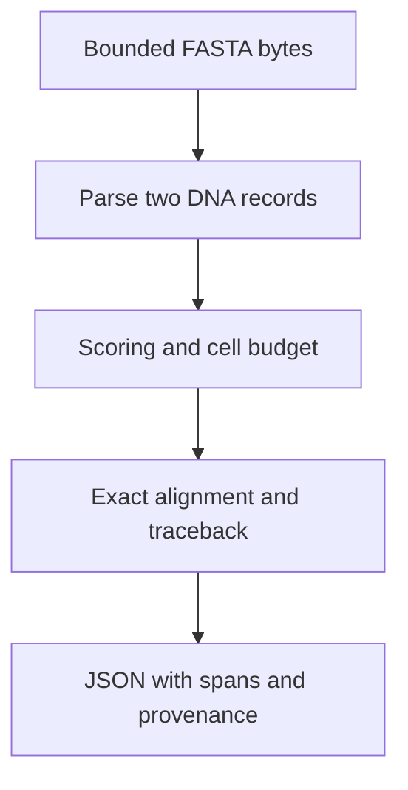

# Build a bounded, reproducible FASTA alignment workbench

**Prepared reference status: STRONG for this bounded pairwise-alignment build; the full bioinformatics domain remains PARTIAL. Learner mastery: NOT STARTED.** The earlier project description named a pipeline without implementing it. This build now has a runnable starter, complete reference CLI, mechanistic lesson, milestone tasks, tests, observed synthetic experiments, and explicit limits.

The problem: given two named DNA strings, produce an optimum correspondence under a specified model and preserve enough provenance to repeat the computation. The output must state its scoring assumptions and consumed coordinates. It must reject malformed or oversized inputs before allocating an unbounded alignment table.

## Learn and prepare

Read [prerequisites](PREREQUISITES.md), then the [complete alignment lesson](../../18-computational-biology/02_SEQUENCE_ALGORITHMS.md). You will derive the recurrence and traceback, distinguish local from global objectives, implement input/resource contracts, and explain why an optimum score is not biological interpretation. Python 3.10+ is the only required tool; no package installation, account, network, or external dataset is needed. All fixture strings are synthetic.

## Architecture and design decisions



The parser accepts ACGTN and uppercases input. The alignment core handles generic strings but reserves `-` for display gaps. The CLI requires two nonempty records with distinct full headers. It reports raw-byte SHA-256, executed source hashes, score parameters, alignment strings, spans, and algorithmic work count. N is a literal symbol, not a wildcard. JSON is printed to stdout; the user chooses whether to save it. This CLI does not send data anywhere.

Raw-byte provenance deliberately distinguishes files whose whitespace differs, even if their parsed sequences are equal. That is byte identity, not authentication, authorship, or biological truth. Global/local choice is explicit; tie priority is documented; scores are integers with nonpositive gap cost. See [production decisions](PRODUCTION.md).

## Build it through milestones

Start with your own attempt and the [runnable inventory starter](starter/inspect_fasta.py). Follow [CHECKPOINTS](CHECKPOINTS.md); save your implementation in your own working folder. Open [HINTS](HINTS.md) only after identifying the specific obstacle. The complete solution lives in [solutions/workbench.py](solutions/workbench.py), with the shared teaching aligner in the biology code directory. Reading the reference is not implementation evidence.

From repository root:

```sh
python3 projects-guided/p14-bioinformatics/starter/inspect_fasta.py projects-guided/p14-bioinformatics/fixtures/toy.fasta
python3 projects-guided/p14-bioinformatics/solutions/workbench.py projects-guided/p14-bioinformatics/fixtures/toy.fasta --mode local
python3 -m unittest discover -s projects-guided/p14-bioinformatics/tests -v
```

The starter prints two record names, both lengths 8, and a raw-input hash. The reference local CLI prints score 8, `ACGT`/`ACGT`, and spans [2,6) for both inputs. It also records source hashes, which legitimately change when code changes. Errors produce no JSON result and a nonzero exit code. [Tests](TESTS.md) explain how to verify this behavior.

## Deliverables and evaluation

Submit your original recurrence derivation; a worked `AG`/`ACG` table; code and tests; a malformed-input transcript; an experiment prediction and actual output; a provenance manifest; and a limits discussion. Use the [exercise set](../../18-computational-biology/alignment/EXERCISES.md) for mathematical practice.

| Criterion | Independently checkable evidence |
| --- | --- |
| Objective and derivation | Explain all three final-column cases, boundaries, optimal-substructure proof, and global/local difference without code |
| Correctness | Reconstruct inputs from displayed strings, rescore columns independently, match the short-input exhaustive oracle |
| Failure handling | Demonstrate rejected invalid symbol, duplicate ID, empty record, byte cap, cell cap, positive gap score |
| Reproducibility | Record exact input/source hashes, Python version, command, parameters, output; explain what hashes cannot prove |
| Experiment | Predict gap sensitivity, execute it, account for ties and alternative explanations |
| Transfer | Rebuild from memory for line-diff strings and state changed assumptions |

A green suite alone does not pass the project. Missing derivation, unexamined score assumptions, fabricated measurements, or biological conclusions unsupported by data make the submission incomplete. Local deployment is simply running this CLI in a controlled environment; no server deployment is required or claimed.

**Reconstruction challenge:** close the lesson and reference; derive both recurrences from the possible final columns, implement traceback/spans, and test an empty case, a tied case, a gap case, a local flanked case, and an invalid input. Reopen only after recording the attempt. Then change the gap model and explain which state the old algorithm loses.
