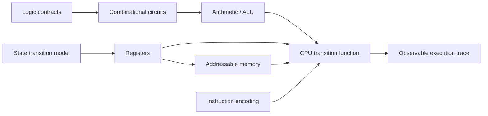

# Proposed Architecture

This describes an intended decomposition; no source files implement it yet.

Interfaces must specify widths, valid inputs, update timing, initial state and error behavior. Pure combinational components have no retained logical state in the proposed model. Stateful components expose an explicit next-state transition; this is a design constraint to test, not a claim about an uninspected upstream implementation.

Keep component implementations separate from reference expectations so tests can detect the same mistaken assumption rather than merely repeat it. The trace should record enough inputs and before/after state to reproduce a failure. No networking or private data is required.
